# Lab 5: Flor de Helia

Un sistema solar de fantasía pastel, pintado por completo con **shaders procedurales en un
software renderer** escrito en C++. Ningún cuerpo usa texturas, mapas de imágenes ni
materiales: cada color se calcula en la CPU, píxel por píxel, con fórmulas.

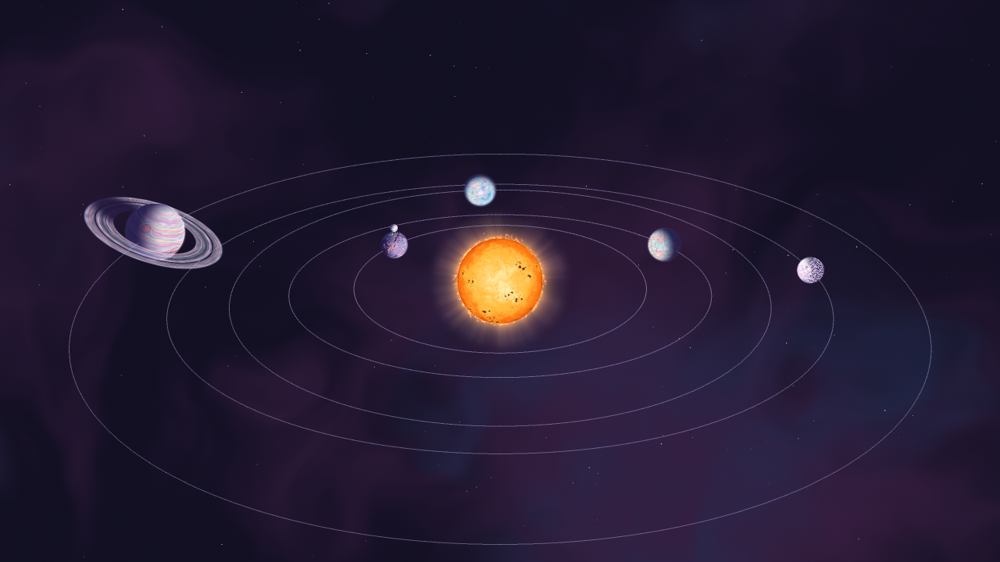

## Concepto artístico

La idea es un mundo de cuento con flores por todas partes y una paleta de **rosa y azul
claro**. Los cuerpos llevan nombres de flores (Malva, Peonía, Floralia, Nenúfar, Hortensia,
Jazmín) y cada uno tiene su propia estructura visual, no solo otra paleta.

El contraste a propósito es **Helia, la estrella**: no es pastel, sino un Sol realista con
granulación, manchas y corona, como en las fotos con filtro solar. Los planetas se ven más
suaves junto a ella. El fondo es un atardecer espacial con nebulosas rosas y celestes.

## Cuerpos y capas procedurales

| Cuerpo | Tipo | Capas que afectan el color |
|---|---|---|
| **Helia** | Estrella | 1. Temperatura y limb darkening · 2. Granulación (Voronoi) · 3. Supergránulos con domain warping · 4. Manchas solares con umbra y penumbra · 5. Fáculas · 6. Filamentos. Además, una corona con serpentinas y prominencias |
| **Malva** | Planeta rocoso | 1. Regiones de terreno · 2. Cordilleras con nieve (ridged noise y bump) · 3. Cráteres con borde, salpicadura y lagos · 4. Vetas de cuarzo rosa · 5. Valles menta y escarcha polar |
| **Peonía** | Gigante gaseoso | 1. Bandas latitudinales · 2. Turbulencia estirada · 3. Tormentas en forma de rosa, que además enrollan las bandas · 4. Óvalos blancos · 5. Bruma polar y de borde. Además, la sombra de su anillo |
| **Floralia** | Planeta jardín (adicional) | 1. Praderas · 2. Ríos · 3. Campos de color · 4. Flores gigantes con dos coronas de pétalos · 5. Flores medianas y florecitas · 6. Polen y nubes |
| **Nenúfar** | Océano de nácar (adicional) | 1. Profundidad · 2. Olas · 3. Iridiscencia de nácar según el ángulo · 4. Nenúfares gigantes con loto · 5. Espuma y corrientes · 6. Nubes en espiral |
| **Hortensia** | Mundo de cristal (adicional) | 1. Facetas con normal propia · 2. Película iridiscente · 3. Grietas brillantes · 4. Vetas internas con parallax · 5. Escarcha y destellos |
| **Jazmín** | Luna de Malva | 1. Mares azul pálido · 2. Cráteres con rayos · 3. Polvo fino · 4. Brillo perlado en el borde |
| **El Velo** | Anillos de Peonía | 1. Densidad por bandas con huecos · 2. Paleta radial · 3. Iridiscencia · 4. Ondas de densidad y granitos brillantes. Además, la sombra del planeta |

## Capturas

Todas son renders reales del programa, generados con `--capturas`.

| | |
|---|---|
| 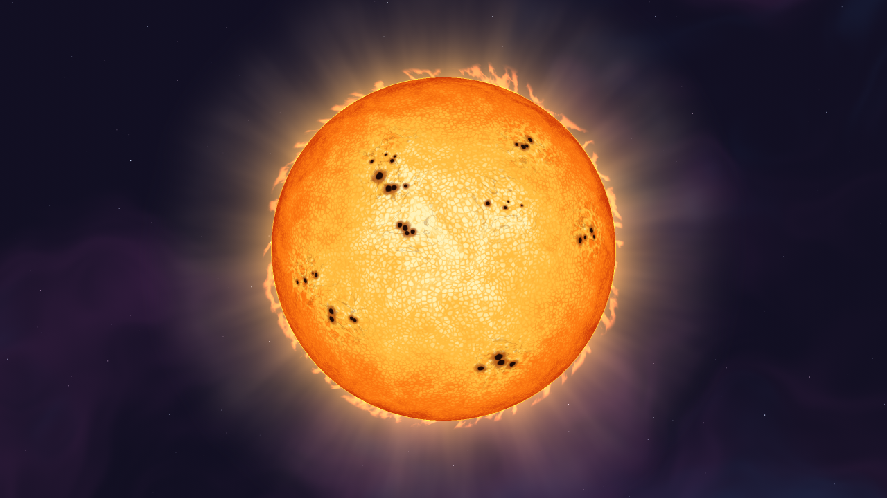 **Helia**, la estrella | 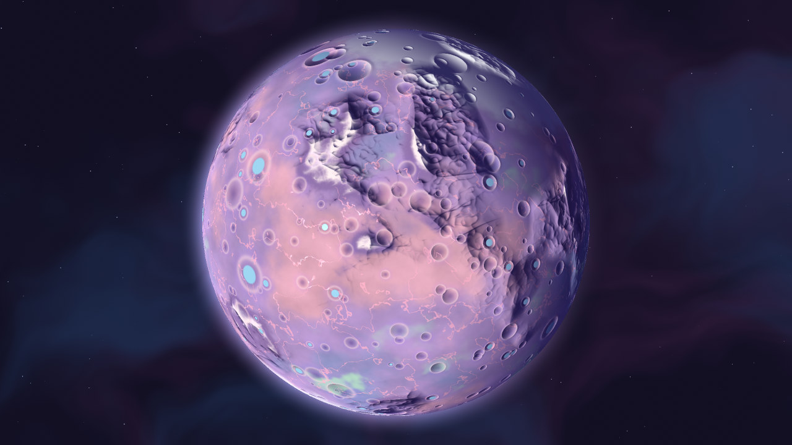 **Malva**, planeta rocoso |
| 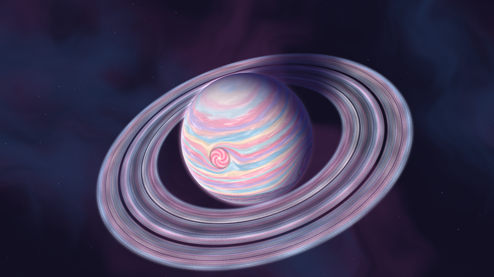 **Peonía**, gigante gaseoso | 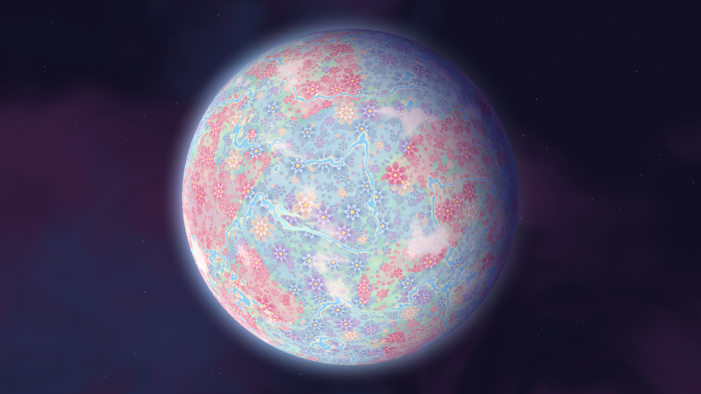 **Floralia**, planeta jardín |
| 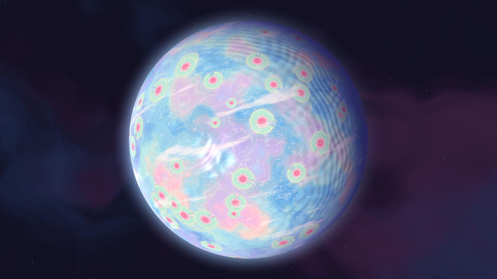 **Nenúfar**, océano de nácar | 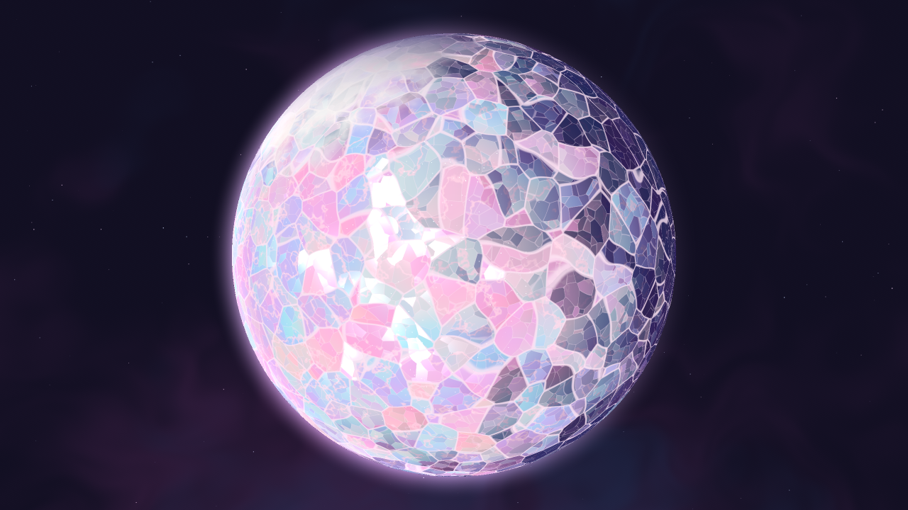 **Hortensia**, mundo de cristal |

### Anillos y luna

| | |
|---|---|
| 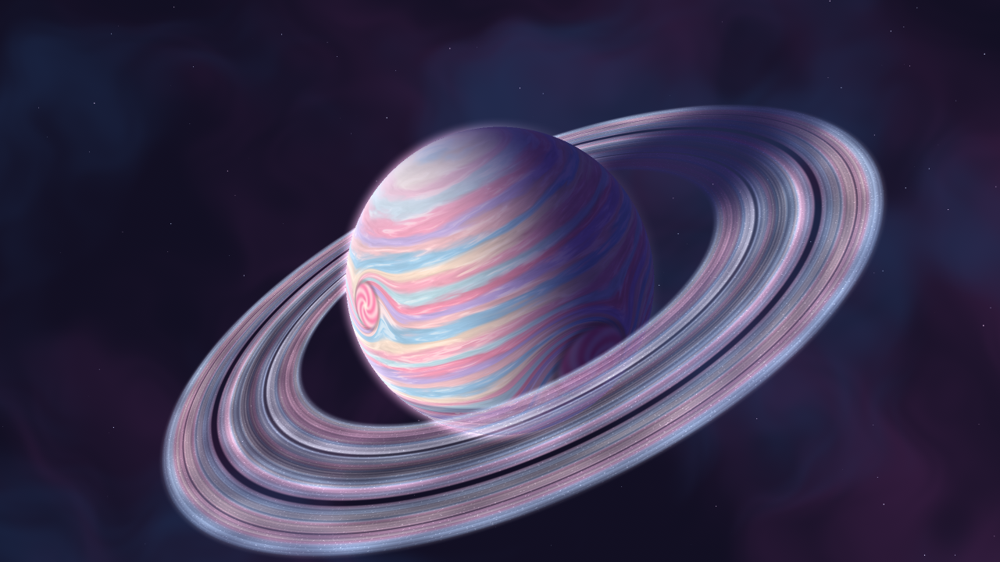 **El Velo**, los anillos de Peonía | 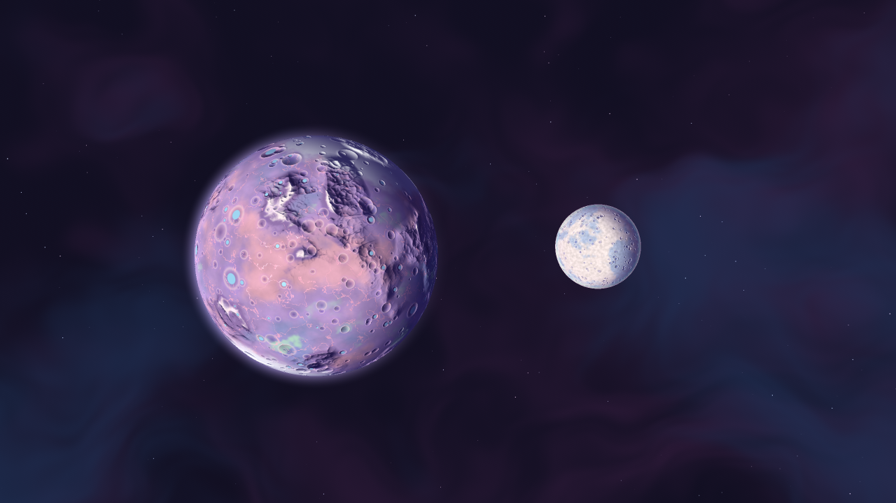 **Malva y Jazmín**, planeta y luna |
| 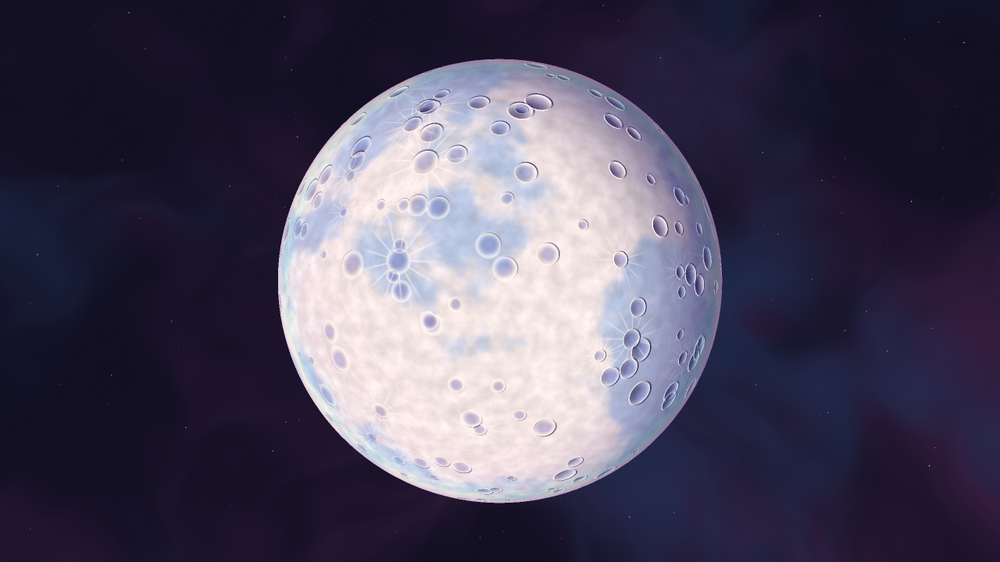 **Jazmín**, la luna de cerca | |

## Requisitos e instalación

- Compilador C++17 (probado con g++ 16.2 de MSYS2 UCRT64)
- CMake ≥ 3.16 y Ninja
- SDL2 (solo para la ventana y el teclado) y GLM (vectores y matrices)

En Windows, con [MSYS2](https://www.msys2.org/), desde la terminal **MSYS2 UCRT64**:

```bash
pacman -S --needed mingw-w64-ucrt-x86_64-gcc mingw-w64-ucrt-x86_64-cmake mingw-w64-ucrt-x86_64-ninja mingw-w64-ucrt-x86_64-SDL2 mingw-w64-ucrt-x86_64-glm
```

## Compilar y ejecutar

Desde la raíz del repositorio y en la misma terminal:

```bash
cmake -S . -B build -G Ninja
cmake --build build
./build/lab5
```

CMake compila en `Release` por defecto. También copia `SDL2.dll` junto al ejecutable, así que
se puede abrir desde PowerShell con `.\build\lab5.exe`.

### Opciones

| Comando | Qué hace |
|---|---|
| `./build/lab5` | Abre la ventana interactiva en el sistema completo |
| `./build/lab5 --vista N` | Empieza en la vista N (1 a 9, o 0 para el sistema) |
| `./build/lab5 --capturas [carpeta]` | Genera las 11 capturas sin abrir ventana (por defecto en `docs/capturas`) |
| `./build/lab5 --medir [segundos]` | Recorre las vistas e imprime los FPS de cada una |
| `./build/lab5 --tamano 960x540` | Cambia la resolución de la ventana (menos píxeles, más FPS) |

## Controles

| Tecla | Acción |
|---|---|
| `1` a `6` | Helia, Malva, Peonía, Floralia, Nenúfar, Hortensia |
| `7` / `8` / `9` | La luna Jazmín / Malva con su luna / anillos de Peonía |
| `0` | Sistema completo |
| `Tab` o flechas | Vista siguiente o anterior |
| Arrastrar con el mouse | Girar la cámara alrededor del cuerpo |
| Rueda o `+` / `-` | Zoom |
| `Espacio` | Pausar o seguir la animación |
| `[` / `]` | Animación más lenta o más rápida |
| `O` | Mostrar u ocultar las órbitas |
| `R` | Regresar la cámara a su posición inicial |
| `C` | Guardar una captura en `capturas/` |
| `Esc` | Salir |

El título de la ventana muestra la vista actual, los FPS, si está en pausa y la velocidad.

## Cómo se calculan los colores sin texturas

1. **Geometría:** las esferas y el anillo se generan por código en [src/mesh.cpp](src/mesh.cpp).
   No traen color, solo posiciones y normales.
2. **Vertex shader** ([src/pipeline.cpp](src/pipeline.cpp)): transforma cada vértice y prepara
   su posición en object space, su posición en world space y su normal.
3. **Rasterizador** ([src/triangle.h](src/triangle.h)): el mismo método de bounding box y
   funciones de arista del Lab 4, ahora con interpolación con perspectiva correcta y z-buffer.
4. **Fragment shader** ([src/shaders/](src/shaders/)): por cada píxel recibe la posición en la
   esfera, la normal, la dirección de la luz, la cámara y el tiempo, y a partir de eso calcula
   el color con funciones matemáticas.

Las herramientas están en [src/noise.h](src/noise.h): Perlin noise 3D, fBm, ridged noise,
Voronoi y una función que riega puntos sobre la esfera. Cada capa es una máscara hecha con
esas funciones más un `mix` de colores. Por ejemplo, una flor es esta fórmula en coordenadas
polares, donde `n` es el número de pétalos:

```cpp
float lobe = std::fabs(std::cos(angle * n * 0.5f));
float outline = size * (0.42f + 0.58f * std::pow(lobe, 0.62f));
```

Todas las seeds son fijas, así que el mismo tiempo y la misma cámara dan la misma imagen.
La única `SDL_Texture` del proyecto es el buffer que SDL usa para mostrar los píxeles ya
calculados en la ventana. No se usa para darle apariencia a ningún cuerpo.

## Relación con la rúbrica

La creatividad es subjetiva, así que esta tabla indica qué se implementó, no una nota.

| Criterio | Implementación |
|---|---|
| Creatividad del diseño (30) | Concepto de fantasía con flores, seis cuerpos con estructuras visuales distintas |
| Complejidad de shaders (40) | Cada cuerpo principal tiene al menos 5 capas identificadas en los comentarios de su shader |
| Tres cuerpos obligatorios | Helia (estrella), Malva (rocoso), Peonía (gaseoso) |
| Planetas adicionales (hasta 30) | Floralia, Nenúfar y Hortensia |
| Anillos sin texturas (20) | El Velo: malla propia, separada del planeta, en [src/shaders/ring.cpp](src/shaders/ring.cpp) |
| Luna (20) | Jazmín: objeto aparte con órbita y shader propios, en [src/shaders/moon.cpp](src/shaders/moon.cpp) |
| Rotación y traslación (opcional) | Todos los planetas giran y orbitan; se puede pausar con `Espacio` |
| Concurso | Se recomienda Floralia (ver abajo) |

## Dónde ajustar los diseños

Cada shader tiene sus capas numeradas y, al inicio del archivo, una sección
`Parámetros para ajustar el look`.

| Archivo | Cuerpo | Parámetros principales |
|---|---|---|
| [src/shaders/star.cpp](src/shaders/star.cpp) | Helia | `GRANULE_SCALE`, `GRANULE_STRENGTH`, `SPOT_RATE`, `BOILING_SPEED` |
| [src/shaders/rocky.cpp](src/shaders/rocky.cpp) | Malva | `REGION_SCALE`, `MOUNTAIN_SCALE`, `MOUNTAIN_BUMP`, `CRATER_SCALE_BIG`, `VEIN_WIDTH`, `FROST_START` |
| [src/shaders/gas.cpp](src/shaders/gas.cpp) | Peonía | `BAND_COUNT`, `BAND_WOBBLE`, `DRIFT_SPEED`, `BAND_COLORS`, tabla `STORMS` |
| [src/shaders/garden.cpp](src/shaders/garden.cpp) | Floralia | `BIG_FLOWER_SCALE`, `MID_FLOWER_SCALE`, `SMALL_FLOWER_SCALE`, `RIVER_WIDTH`, `CLOUD_COVER` |
| [src/shaders/ocean.cpp](src/shaders/ocean.cpp) | Nenúfar | `WAVE_FREQ`, `WAVE_BUMP`, `PAD_SCALE`, `IRIDESCENCE`, `CLOUD_START` |
| [src/shaders/crystal.cpp](src/shaders/crystal.cpp) | Hortensia | `FACET_SCALE`, `FACET_TILT`, `CRACK_WIDTH`, `PARALLAX_DEPTH`, `FROST_START` |
| [src/shaders/moon.cpp](src/shaders/moon.cpp) | Jazmín | `MARIA_SCALE`, `CRATER_SCALE`, `CRATER_DENSITY`, `PEARL_STRENGTH` |
| [src/shaders/ring.cpp](src/shaders/ring.cpp) | El Velo | `SHEEN`, `SPARKLE`, centros de los huecos en `ringDensity` |
| [src/scene.cpp](src/scene.cpp) | Todos | Radios, órbitas, velocidades, halos, encuadres de cada vista |

El cielo está en [src/shaders/sky.cpp](src/shaders/sky.cpp), los halos en
[src/shaders/atmosphere.cpp](src/shaders/atmosphere.cpp) y la iluminación compartida
(`pastelLight`) en [src/shaders/shader.h](src/shaders/shader.h).

## Rendimiento

El renderer dibuja en todos los hilos del CPU, repartiendo la pantalla en bandas horizontales.
Estos son los FPS medidos con `--medir 4` a 1280×720, en un Intel Core i5-13500H (16 hilos):

| Vista | FPS | Vista | FPS |
|---|---:|---|---:|
| Helia | 23 | Hortensia | 21 |
| Malva | 14 | Jazmín | 40 |
| Peonía | 46 | Malva y su luna | 30 |
| Floralia | 13 | Anillos de Peonía | 40 |
| Nenúfar | 19 | Sistema completo | 45 |

Las capturas se renderizan al doble de resolución y se promedian (supersampling), mientras
que la ventana dibuja a resolución normal. Por eso las capturas tienen los bordes más suaves.

## Regenerar las capturas

```bash
./build/lab5 --capturas
```

Esto escribe los PNG en `docs/capturas/`, sin comprimir porque el escritor PNG no depende de
ninguna librería. Los que están en el repo además se comprimieron sin cambiar ningún píxel con
un script opcional que necesita Pillow:

```bash
python tools/comprimir_capturas.py
```

## Cuerpo recomendado para el concurso: Floralia

Se recomienda **Floralia** porque es el diseño más propio del concepto. Toda su superficie está
cubierta de flores generadas por fórmula, con pétalos, venitas y centro, en tres escalas, y
organizadas en campos de color separados por ríos.

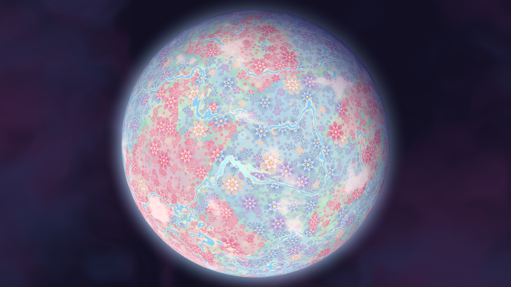

La captura es de 1920×1080 con supersampling de 3x. Una alternativa muy vistosa es Peonía con
sus anillos.

## Créditos y dependencias

- **Modelos 3D:** ninguno externo. Todas las mallas se generan por código.
- **[SDL2](https://www.libsdl.org/)** (licencia zlib): ventana, eventos y presentación del framebuffer.
- **[GLM](https://github.com/g-truc/glm)** (licencia MIT): vectores y matrices.
- **Base del renderer:** framebuffer, rasterizador, cargador OBJ y escritor PNG del
  [Lab 4](https://github.com/EmilyGG24308/Lab-4-GRAFICAS). El cargador OBJ sigue en el repo
  porque define el struct `Model`, pero este proyecto no carga ningún archivo `.obj`.
- **Técnicas conocidas, implementadas aquí desde cero:** Perlin noise (Ken Perlin), ruido
  celular (Steven Worley), paleta de cosenos (Iñigo Quilez), interleaved gradient noise para el
  dithering (Jorge Jimenez) y una aproximación polinómica de limb darkening.
